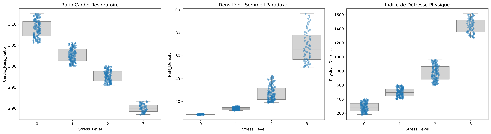

# Digital Health Monitoring : Analyse Prédictive du Stress par Machine Learning

> Projet d'analyse physiopathologique et de modélisation prédictive du niveau de stress à partir de biomarqueurs du sommeil et du système nerveux autonome.

---

## Contexte et Objectif
Ce projet explore la relation entre les paramètres physiologiques nocturnes et les niveaux de stress (échelonnés de 0 à 3). L'objectif est de concevoir un pipeline de Machine Learning transparent, explicable et rigoureux.

---

## Ingénierie des Biomarqueurs
1. **`Cardio_Resp_Ratio`** : Évalue le comportement du système nerveux autonome.
2. **`REM_Density`** : Indicateur de la qualité et de la proportion de sommeil paradoxal.
3. **`Physical_Distress`** : Capte l'agitation nocturne (`Limb_Movement * Snoring_Rate`).

---

## Visualisation des Résultats


---

## Utilisation
```bash
python3 analyse_stress.py
